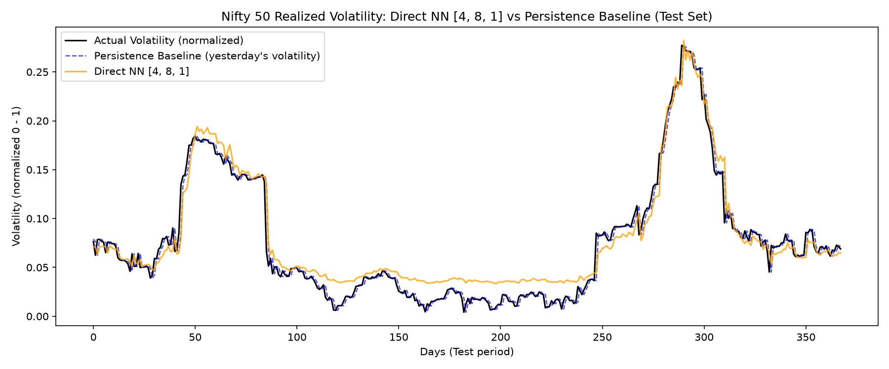

# Neural Network From Scratch — Nifty 50 Volatility Forecasting

I built a feedforward neural network from scratch in NumPy (forward pass, backpropagation, momentum, L2 regularization, and both per-sample SGD and mini-batch gradient descent) and applied it to forecasting 21-day realized volatility on the Nifty 50 index (`^NSEI`, 2019–2026).

All backpropagation calculus was worked out on paper before coding (`derivations/derivations.md`, with photographed handwritten notes) and verified with numerical finite-difference gradient checks (`tests/gradient_check.py`) and XOR convergence tests (`src/train_xor.py`, `src/train_xor_batched.py`).

## Results

On the chronological 70/10/20 split (`1,285` train / `184` validation / `368` test rows), with inputs Z-scored and targets Min-Max scaled using training statistics only, early-stopped on validation loss:

| Model | Test MSE (normalized scale) |
|---|---|
| Persistence baseline (predict `y_t = Volatility_lag1`) | **0.000089** |
| Direct NN (`[4, 8, 1]`, `[leaky_relu, sigmoid]`) | 0.000235 |
| Follow-up 1: Residual NN (predict `y_t - Volatility_lag1`) | **0.000087** |
| Follow-up 2: Log-volatility NN (predict `log(Volatility)`) | 0.000130 |

**The honest takeaway:** the persistence baseline beats the direct neural network (`0.000089` vs `0.000235`). Because 21-day rolling volatility at day `t` shares 20 of 21 daily returns with day `t - 1`, yesterday's volatility is already very close to today's. When I reformulated the target as the daily change (`y_t - Volatility_lag1`) and added the network's output back to persistence, test MSE dropped to `0.000087` — essentially matching persistence with a small (~2%) edge. Predicting `log(Volatility)` (`0.000130`) improved over direct level prediction but still lost to persistence.



## Limitations

- **Autocorrelated target:** 21-day rolling volatility changes slowly from one day to the next, so a simple `[4, 8, 1]` network trained on 4 lagged features barely improves on persistence even when predicting residuals.
- **Loss convention:** `NeuralNetwork.backward()` starts from `(y_pred - y_true) * output_derivative(z)`, omitting the factor of `2` from `mse_derivative`. Effectively, the network minimizes `0.5 * (y_pred - y_true)^2`, which halves the effective learning rate.
- **Uncontrolled sklearn comparison removed:** Earlier versions compared against `sklearn.MLPRegressor` with default hyperparameters (`Adam`, `batch_size=200`, no early stopping), which was not a fair or controlled baseline.

## What I got wrong

After a technical review of this repository, I found and fixed three major mistakes in my earlier work:

1. **Invalid naive baseline (`0.346384` vs `0.000089`):** In my original `train_volatility.py`, I computed the naive baseline using Z-scored `X_test_norm[:, 2]` against Min-Max scaled `y_test_norm`. Comparing two different scales inflated the naive MSE to `0.346384` and made it look like the network was ~1,950x better than persistence. Once placed in the same Min-Max scale, persistence scores `0.000089` (and `0.000086` on the old 80/20 split), beating the direct network.
2. **Misdiagnosed "dying ReLU" (Day 9 to Day 11):** On Day 9, adding `Volatility_ma10_lag1` caused test MSE to jump to `0.001255`, which I blamed on dying ReLU neurons and thought Leaky ReLU fixed on Day 11. Re-testing showed that `0.001255` was actually caused by an old bug in `network.py` that applied `a * (1 - a)` to ReLU hidden outputs. With the Day 11 `DERIVATIVES` lookup fix, plain `relu` and `leaky_relu` perform nearly identically (`0.000236` vs `0.000235` on 70/10/20). I kept the original Day 9–11 notes intact in `derivations/derivations.md` and added a dated correction beside them.
3. **Unused mini-batch gradient descent:** I originally claimed mini-batch gradient descent was implemented, even though `Dense.forward`/`backward` only handled 1D single-sample vectors, `batch_size = 32` in `train_volatility.py` was unused, and `train_xor_batched.py` updated weights per sample inside the batch loop. I have now added real 2D mini-batch support to `Dense`, updated `train_xor_batched.py` to update once per batch, and verified both SGD and mini-batch paths with `tests/gradient_check.py`.

## Project structure

- `src/` — neural network implementation (`layers.py`, `network.py`, `activations.py`, `losses.py`), data pipeline (`data_pipeline.py`), and training scripts (`train_xor.py`, `train_xor_batched.py`, `train_volatility.py`)
- `tests/` — finite-difference gradient check (`gradient_check.py`) for `sigmoid`, `relu`, and `leaky_relu` in both SGD and mini-batch modes
- `data/` — raw, processed, and model-ready Nifty 50 CSVs
- `derivations/` — hand-derived math notes and photographed derivations (`derivations.md`, `day1_p1.jpg`–`day11_p2.jpeg`)
- `notebooks/` — prediction plot (`volatility_predictions.png`)

## Running it

```bash
python tests/gradient_check.py   # verify analytical vs numerical gradients
cd src
python train_xor.py              # XOR in per-sample SGD mode
python train_xor_batched.py      # XOR in mini-batch mode (batch_size=2)
python train_volatility.py       # train and evaluate Nifty 50 volatility models
```
